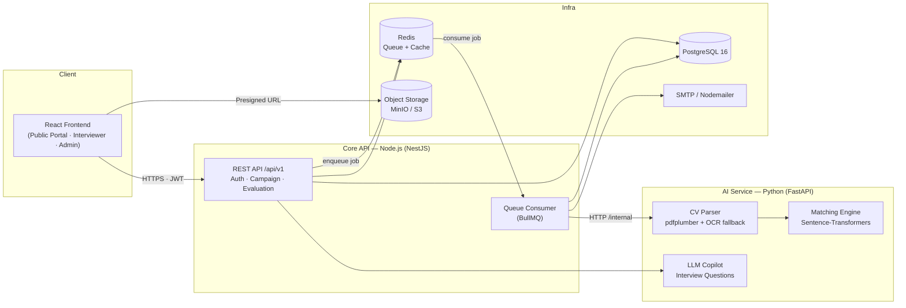
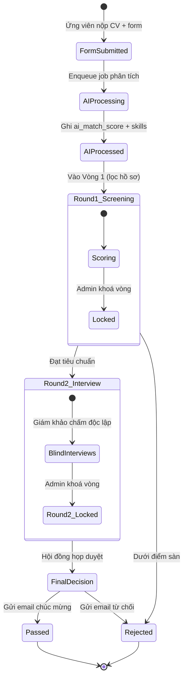
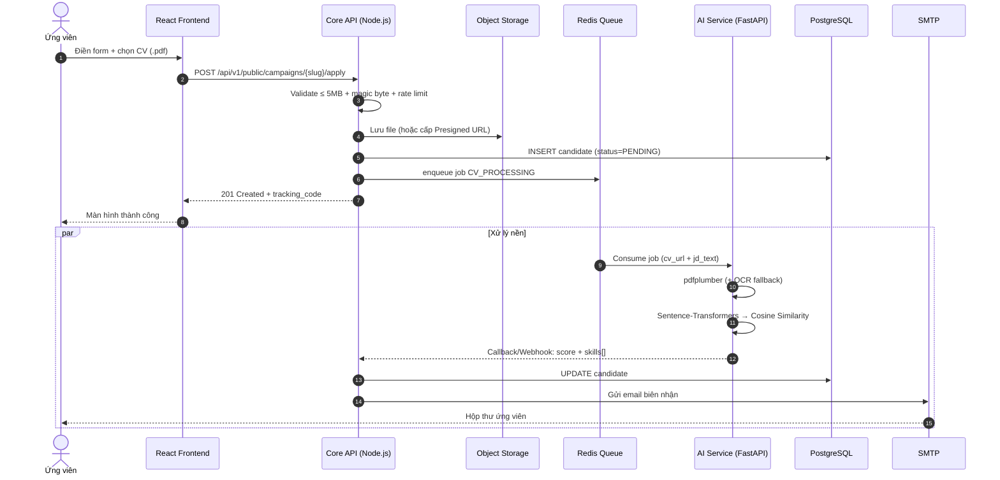
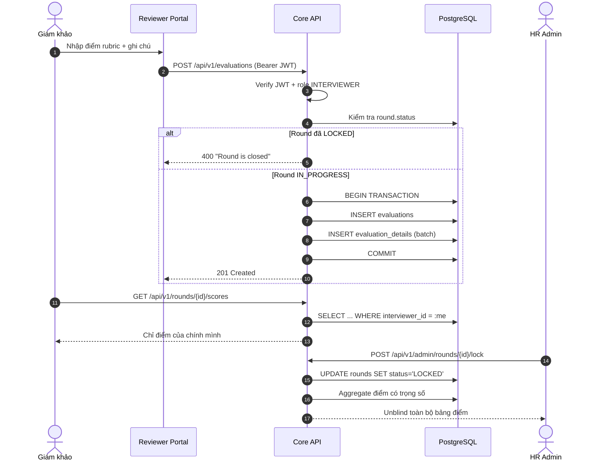
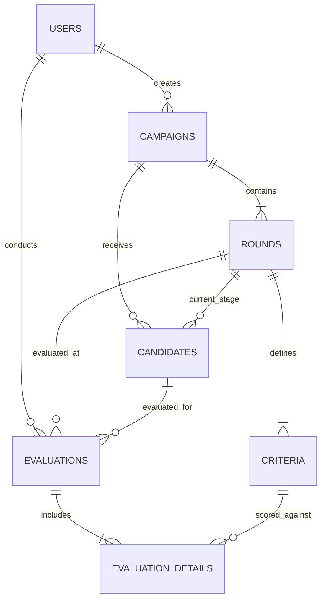

# AI-Powered Internal ATS

**Hệ thống Quản lý Tuyển dụng & Lọc CV bằng AI** — ATS nội bộ cho doanh nghiệp vừa và nhỏ.

<p>
  
  
  
  
  
</p>

> **Trạng thái hiện tại:** Tài liệu SRS / Product Backlog / System Design đã ở mức *Baseline Approved* (v2.0.0). Repository đang ở giai đoạn **khởi tạo — chưa có mã nguồn**. README này đóng vai trò là **nguồn sự thật duy nhất (single source of truth)** về kiến trúc, tech stack và lộ trình triển khai.

---

## Mục lục

- [1. Bài toán & Mục tiêu](#1-bài-toán--mục-tiêu)
- [2. Tác nhân & Phân quyền](#2-tác-nhân--phân-quyền)
- [3. Phạm vi tính năng](#3-phạm-vi-tính-năng)
- [4. Kiến trúc hệ thống](#4-kiến-trúc-hệ-thống)
- [5. Tech Stack](#5-tech-stack)
- [6. Luồng nghiệp vụ chính](#6-luồng-nghiệp-vụ-chính)
- [7. Mô hình dữ liệu](#7-mô-hình-dữ-liệu)
- [8. Bảo mật & Tuân thủ](#8-bảo-mật--tuân-thủ)
- [9. Architecture Decision Records](#9-architecture-decision-records)
- [10. API Contracts](#10-api-contracts)
- [11. Roadmap triển khai](#11-roadmap-triển-khai)
- [12. Cấu trúc repository dự kiến](#12-cấu-trúc-repository-dự-kiến)
  - [Checklist thực thi chi tiết →](docs/BUILD-CHECKLIST.md)
- [13. Getting Started](#13-getting-started)
- [14. Tài liệu tham chiếu](#14-tài-liệu-tham-chiếu)

---

## 1. Bài toán & Mục tiêu

### Bối cảnh

Các doanh nghiệp vừa và nhỏ thường xử lý tuyển dụng bằng Google Form + Google Sheets + email thủ công, dẫn tới:

- **Không có nguồn dữ liệu tập trung** — CV nằm rải rác trong hộp thư của từng HR.
- **Lọc CV thủ công** — 100+ hồ sơ cho một vị trí, mất 2–3 ngày chỉ để sàng lọc sơ bộ.
- **Thiên lệch khi chấm điểm** — giám khảo nhìn thấy điểm của nhau, dẫn tới hiệu ứng *anchoring* và *groupthink*.
- **Ứng viên mù thông tin** — không biết hồ sơ đang ở vòng nào, phải gọi điện hỏi HR.

### Mục tiêu dự án

| # | Mục tiêu | Chỉ số đo lường |
|---|---|---|
| G1 | Tự động hoá sàng lọc hồ sơ đầu vào | Giảm ≥ 70% thời gian lọc CV thủ công |
| G2 | Chấm điểm phỏng vấn khách quan | 100% giám khảo chấm độc lập, không thấy điểm đồng nghiệp |
| G3 | Minh bạch với ứng viên | Ứng viên tự tra cứu trạng thái 24/7 qua mã tracking |
| G4 | Truy vết & kiểm toán | Mọi thao tác thay đổi điểm / khoá vòng đều có audit log |

### Định vị cá nhân

Dự án được thiết kế và triển khai nhằm thể hiện năng lực ở vị trí **Fullstack AI Engineer**: tự tay xây dựng cả tầng ứng dụng (Node.js/React) lẫn tầng AI (Python/FastAPI), thay vì chỉ gọi API của bên thứ ba.

---

## 2. Tác nhân & Phân quyền

| Tác nhân | Vai trò hệ thống | Quyền chính |
|---|---|---|
| **Ứng viên (Guest)** | Không cần tài khoản | Xem đợt tuyển, nộp CV, tra cứu trạng thái bằng `tracking_code` |
| **Giám khảo** | `INTERVIEWER` | Xem ứng viên được gán, chấm điểm theo rubric, xem gợi ý câu hỏi từ AI Copilot |
| **Trưởng ban / HR Manager** | `ADMIN` | CRUD campaign, cấu hình round & rubric, khoá vòng (unblind), tổng hợp & gửi kết quả |

**Nguyên tắc phân quyền:** RBAC được thực thi ở **tầng Data Access (SQL scoped query)**, không phải ở tầng UI.

---

## 3. Phạm vi tính năng

Trích từ Product Backlog (Scrum, Fibonacci Story Points, MoSCoW).

| ID | Epic | Mô tả ngắn | SP | Ưu tiên |
|---|---|---|---|---|
| **US-01** | Identity & Auth | Đăng nhập Email/Password, bcrypt hash, JWT Access 15m + HttpOnly Refresh Cookie 7d | 3 | Must |
| **US-02** | Campaign Mgmt | CRUD campaign (title, slug, date, JD), tạo nhiều Round, mỗi Round có nhiều Criteria; tổng `weight` = 1.00 | 5 | Must |
| **US-03** | Public Portal | Nộp CV PDF ≤ 5MB không cần đăng ký, magic-byte check, sinh `tracking_code`, bắn event sang AI Service | 5 | Must |
| **US-04** | AI Matching | Bóc tách text CV, tính độ tương đồng ngữ nghĩa với JD, lưu `ai_match_score` + `ai_parsed_skills` | 8 | Must |
| **US-05** | Interview Eval | Nhập điểm theo từng criterion, chỉ khi Round `IN_PROGRESS`, lưu bằng transaction, 1 phiếu/giám khảo/vòng | 5 | Must |
| **US-06** | Blind Scoring | Giám khảo chỉ thấy điểm của chính mình; trả 403 nếu truy vấn điểm người khác; unblind khi Round `LOCKED` | 5 | Must |
| **US-07** | Notification | Email bất đồng bộ khi nộp đơn thành công và khi có kết quả đậu/rớt | 3 | Should |
| **US-08** | AI Copilot | Sinh 3–5 câu hỏi phỏng vấn dựa trên khoảng trống kỹ năng giữa CV và JD | 5 | Could |

**Tổng:** 39 Story Points — tương đương **2 sprint** cho một lập trình viên có kinh nghiệm.

---

## 4. Kiến trúc hệ thống

### 4.1. Kiến trúc mục tiêu (Target Architecture)



### 4.2. Nguyên tắc thiết kế

| Nguyên tắc | Cách hiện thực |
|---|---|
| **Tách CPU-bound khỏi I/O-bound** | Node.js chỉ xử lý request/response; mọi tác vụ nặng (parse PDF, embedding) đẩy sang FastAPI |
| **Bất đồng bộ hoá đường ghi** | Upload CV trả `201` ngay, việc phân tích chạy nền qua queue, có retry + DLQ |
| **Bảo mật ở tầng dữ liệu** | Blind scoring lọc bằng `WHERE interviewer_id = :current_user_id` |
| **Toàn vẹn giao dịch** | Phiếu điểm (cha + con) nằm trong một `BEGIN ... COMMIT` |
| **Không đoán được URL** | `tracking_code` entropy cao thay cho ID tuần tự (chống IDOR) |
| **Fail-safe** | Nếu AI Service chết, hồ sơ vẫn được lưu với `ai_match_score = NULL` và có thể re-run |

---

## 5. Tech Stack

Ký hiệu: **Đã chốt** = có trong SRS v2.0.0 · **Bổ sung** = quyết định kỹ thuật mới, ghi nhận tại [mục 9](#9-architecture-decision-records).

### 5.1. Stack đã chốt trong SRS

| Tầng | Công nghệ | Vai trò | Trạng thái |
|---|---|---|---|
| Frontend | **React** | Public Portal, Interviewer Portal, Admin Dashboard | Đã chốt |
| Core Backend | **Node.js** | REST API, auth, campaign, evaluation, lock round | Đã chốt |
| AI Service | **Python + FastAPI** | Microservice bóc tách CV, matching, LLM copilot | Đã chốt |
| Database | **PostgreSQL** | Lưu trữ quan hệ, hỗ trợ `jsonb`, `decimal`, `enum` | Đã chốt |
| Auth | **bcrypt + JWT** (Access 15m / HttpOnly Refresh Cookie 7d) | Xác thực & phân quyền | Đã chốt |
| CV Parsing | **pdfplumber** | Trích xuất text từ PDF | Đã chốt |
| AI Matching | **Sentence-Transformers + Cosine Similarity** | Tính điểm tương đồng CV ↔ JD | Đã chốt |
| AI Copilot | **LLM prompting** | Sinh câu hỏi phỏng vấn từ skill gap | Đã chốt (chưa chọn vendor) |
| Email | **Nodemailer / SMTP** | Thông báo biên nhận & kết quả | Đã chốt |
| Upload | **multipart/form-data**, ≤ 5MB, **magic-byte check** | Tiếp nhận CV | Đã chốt |
| Service-to-Service | **RESTful API nội bộ** | Core API ↔ AI Service | Đã chốt |
| Quy trình | **Scrum / Agile** (Gherkin, MoSCoW, Fibonacci) | Quản lý phạm vi | Đã chốt |

### 5.2. Stack bổ sung để đạt chuẩn production

| Tầng | Công nghệ | Lý do bổ sung |
|---|---|---|
| Frontend | **TypeScript · Vite · TanStack Query · React Hook Form · Zod · Tailwind + shadcn/ui** | Type-safe end-to-end; schema validate dùng chung với backend |
| Core Backend | **NestJS · TypeScript · Prisma** | Guard/Interceptor cho RBAC & audit log; Prisma transaction cho ADR-03; migration sinh từ ERD |
| AI Service | **Pydantic v2 · `bge-m3` · Structured Output (JSON mode)** | `bge-m3` đa ngôn ngữ Anh–Việt tốt hơn MiniLM; Pydantic đảm bảo output có schema |
| OCR Fallback | **PaddleOCR / Tesseract** | Xử lý CV dạng ảnh quét, CV xuất từ Canva |
| Async | **Redis 7 + BullMQ** | Retry, backoff, DLQ — thay cho HTTP call trực tiếp (ADR-05) |
| Object Storage | **MinIO (dev) → S3 / Cloudflare R2 (prod)** + Presigned URL | Không phụ thuộc disk container (ADR-06) |
| Observability | **Pino · OpenTelemetry · Sentry** | Truy vết lỗi xuyên service |
| Testing | **Jest + Supertest · Pytest · Playwright** | Kiểm chứng Acceptance Criteria |
| Hạ tầng | **Docker Compose · GitHub Actions · Nginx** | Dựng môi trường bằng một lệnh, CI tự động |
| Tài liệu API | **OpenAPI 3.1 / Swagger UI** | Contract-first giữa FE–BE–AI |

### 5.3. Khoảng trống đã biết

Các mục dưới đây **cố tình để mở** và sẽ được chốt ở Phase 1:

- [x] ~~Framework Node.js~~ → **NestJS** (ADR-08)
- [x] ~~Nơi lưu file CV~~ → **Object Storage + Presigned URL** (ADR-06)
- [x] ~~Cơ chế gọi AI Service~~ → **Message Queue** (ADR-05)
- [ ] Nhà cung cấp LLM cho US-08 (OpenAI / Gemini / Ollama self-host)
- [ ] Chiến lược multi-tenant (nếu mở rộng cho nhiều công ty)

---

## 6. Luồng nghiệp vụ chính

### 6.1. Vòng đời hồ sơ ứng viên



### 6.2. Luồng nộp đơn & phân tích AI (bất đồng bộ)



### 6.3. Luồng Blind Scoring



---

## 7. Mô hình dữ liệu

### 7.1. Sơ đồ quan hệ



### 7.2. Từ điển dữ liệu

| Bảng | Trường quan trọng | Ghi chú |
|---|---|---|
| `users` | `email` (UK), `password_hash`, `role` (ADMIN/INTERVIEWER), `status` | Không có role CANDIDATE — ứng viên là khách |
| `campaigns` | `slug` (UK), `status` (DRAFT/OPEN/CLOSED), `created_by` | `slug` dùng cho URL public |
| `rounds` | `campaign_id`, `order_index`, `status` (PENDING/IN_PROGRESS/LOCKED) | `LOCKED` là điều kiện unblind |
| `criteria` | `round_id`, `max_score`, `weight` | Ràng buộc: `SUM(weight) = 1.00` mỗi round |
| `candidates` | `tracking_code` (UK), `cv_file_url`, `ai_match_score`, `ai_parsed_skills` (jsonb), `final_status` | `ai_*` nullable để chịu lỗi AI Service |
| `evaluations` | `round_id`, `candidate_id`, `interviewer_id`, `total_score` | **UNIQUE** `(round_id, candidate_id, interviewer_id)` |
| `evaluation_details` | `evaluation_id`, `criterion_id`, `score`, `comment` | Bảng con, ghi trong cùng transaction |

### 7.3. Ràng buộc bắt buộc ở tầng DB

```sql
-- Chống nộp trùng phiếu điểm (thay vì chỉ check ở application layer)
ALTER TABLE evaluations
  ADD CONSTRAINT uq_eval_per_round_candidate_interviewer
  UNIQUE (round_id, candidate_id, interviewer_id);

-- Tra cứu tracking phải là O(1)
CREATE UNIQUE INDEX idx_candidates_tracking_code ON candidates (tracking_code);

-- Sắp xếp ứng viên theo điểm AI là truy vấn nóng nhất của Admin
CREATE INDEX idx_candidates_campaign_score
  ON candidates (campaign_id, ai_match_score DESC NULLS LAST);

-- Ràng buộc tổng weight của rubric
ALTER TABLE criteria
  ADD CONSTRAINT chk_weight_range CHECK (weight >= 0 AND weight <= 1);
```

---

## 8. Bảo mật & Tuân thủ

| Nhóm | Biện pháp | Đối ứng |
|---|---|---|
| **Xác thực** | bcrypt, JWT ngắn hạn, Refresh Cookie `HttpOnly + Secure + SameSite=Strict` | US-01 |
| **Uỷ quyền** | RBAC ở tầng query; Blind Scoring bằng SQL filter | ADR-02 |
| **Chống IDOR** | `tracking_code` entropy cao, không lộ ID tuần tự | ADR-04 |
| **Upload an toàn** | Giới hạn 5MB, magic-byte check, đổi tên file, **quét malware (ClamAV)**, render PDF trong sandbox | US-03 |
| **Chống spam** | Rate limit theo IP (Redis), CAPTCHA (Turnstile) cho form public | Bổ sung |
| **Toàn vẹn** | ACID transaction; UNIQUE constraint ở DB | ADR-03 |
| **Truy vết** | `audit_logs`: ai sửa điểm, ai khoá vòng, thời điểm, IP | ADR-07 |
| **Dữ liệu cá nhân** | Mask PII trước khi gửi LLM; chính sách xoá hồ sơ theo yêu cầu (NĐ 13/2023/NĐ-CP, GDPR) | Bổ sung |
| **Bí mật** | `.env` không commit; secret qua Docker secret / vault | Bổ sung |

---

## 9. Architecture Decision Records

### ADR-01 — Tách AI Service bằng Python FastAPI

- **Bối cảnh:** Node.js chạy single-thread Event Loop. Trích xuất PDF và tính vector embedding là tác vụ CPU-bound, sẽ chặn toàn bộ luồng I/O.
- **Quyết định:** AI Service là microservice độc lập (FastAPI), giao tiếp với Core API qua REST nội bộ hoặc Message Queue.
- **Hệ quả:** (+) Core API giữ độ trễ thấp; AI scale độc lập theo tải. (−) Tăng độ phức tạp vận hành, cần thêm observability xuyên service.

### ADR-02 — Blind Scoring thực thi ở tầng Database/Backend

- **Bối cảnh:** Nhiều hệ thống trả toàn bộ điểm về Frontend rồi ẩn bằng CSS/JS — giám khảo chỉ cần mở Network Tab là thấy điểm đồng nghiệp.
- **Quyết định:** Chèn `WHERE interviewer_id = :current_user_id` khi round chưa `LOCKED`.
- **Hệ quả:** (+) Bảo mật thực chất, không thể bypass từ client. (−) Không thể tái sử dụng endpoint cho Admin mà không tách nhánh quyền.

### ADR-03 — Toàn vẹn dữ liệu bằng Database Transaction

- **Bối cảnh:** Một phiếu đánh giá gồm 1 record cha (`evaluations`) và N record con (`evaluation_details`). Mất kết nối giữa chừng sẽ tạo dữ liệu mồ côi.
- **Quyết định:** Bọc `BEGIN ... COMMIT / ROLLBACK`.
- **Hệ quả:** (+) Không có phiếu điểm nửa vời. (−) Transaction giữ lock lâu hơn, cần giữ payload nhỏ.

### ADR-04 — Chống IDOR bằng Tracking Code ngẫu nhiên

- **Bối cảnh:** `/track/1`, `/track/2` cho phép crawl toàn bộ hồ sơ ứng viên.
- **Quyết định:** Sinh mã `APP-YYYY-XXXX` với entropy cao.
- **Hệ quả:** (+) Không thể enumerate. (−) Ứng viên phải lưu mã; cần email nhắc lại.

### ADR-05 — Chuyển Core API → AI Service sang Message Queue

- **Bối cảnh:** Sequence Diagram ban đầu gọi HTTP trực tiếp `POST /internal/v1/ai/parse-and-match`. Khi 100 CV nộp đồng thời, FastAPI bị nghẽn, request bị timeout và **mất job không có retry**. Đây là mâu thuẫn nội tại của SRS v2.0.0.
- **Quyết định:** Dùng **Redis + BullMQ**. Core API enqueue `CV_PROCESSING`, worker tiêu thụ, cấu hình `attempts: 3`, exponential backoff, DLQ cho job thất bại.
- **Hệ quả:** (+) Chịu tải, có retry, tách rời vòng đời request. (−) Kết quả AI là *eventually consistent* — UI phải polling hoặc dùng WebSocket.

### ADR-06 — Lưu CV trên Object Storage

- **Bối cảnh:** `cv_file_url` xuất hiện trong ERD nhưng chưa xác định nơi lưu. Local disk sẽ mất file khi container restart và không chia sẻ được giữa các replica.
- **Quyết định:** **MinIO** ở môi trường dev, **S3 / Cloudflare R2** ở production. Upload qua **Presigned URL**, bucket private, truy cập bằng signed URL có TTL ngắn.
- **Hệ quả:** (+) Stateless API, scale ngang dễ dàng. (−) Thêm một thành phần hạ tầng và chi phí egress.

### ADR-07 — Audit Log & UNIQUE Constraint cho tính công bằng

- **Bối cảnh:** Hệ thống tuyển dụng phải chứng minh được tính công bằng khi có khiếu nại. Ngoài ra, chặn trùng phiếu điểm chỉ ở application layer sẽ thất bại khi có race condition.
- **Quyết định:** Bảng `audit_logs` ghi mọi mutation nhạy cảm (`evaluation.create/update`, `round.lock`); UNIQUE `(round_id, candidate_id, interviewer_id)` ở DB.
- **Hệ quả:** (+) Có bằng chứng kiểm toán, không thể double-submit. (−) Tăng dung lượng DB, cần chính sách lưu trữ.

### ADR-08 — Chọn NestJS + Prisma cho Core API

- **Bối cảnh:** SRS chỉ ghi "Node.js", để mở framework và ORM.
- **Quyết định:** **NestJS** (DI, Guard, Interceptor, tích hợp Swagger) + **Prisma** (type-safe, migration từ ERD).
- **Hệ quả:** (+) Cấu trúc module khớp với Epic trong backlog; Guard ánh xạ trực tiếp RBAC. (−) Đường cong học tập cao hơn Express thuần.

---

## 10. API Contracts

| Method | Endpoint | Quyền | Request | Response |
|---|---|---|---|---|
| `POST` | `/api/v1/auth/login` | Public | `{ email, password }` | `200` + Access Token, `Set-Cookie` Refresh |
| `POST` | `/api/v1/auth/refresh` | Cookie | — | `200` + Access Token mới (rotation) |
| `GET` | `/api/v1/public/campaigns` | Public | `?status=OPEN` | `200` + danh sách campaign |
| `POST` | `/api/v1/public/campaigns/:slug/apply` | Public | `multipart: full_name, email, phone, cv_file` | `201` + `{ tracking_code }` |
| `GET` | `/api/v1/public/track/:code` | Public | — | `200` + `{ candidate, status }` |
| `POST` | `/api/v1/campaigns` | Admin | `{ title, slug, description, start_date, end_date }` | `201` |
| `POST` | `/api/v1/campaigns/:id/rounds` | Admin | `{ round_name, order_index, criteria[] }` | `201` |
| `GET` | `/api/v1/rounds/:id/candidates` | Interviewer/Admin | — | `200` |
| `POST` | `/api/v1/evaluations` | Interviewer | `{ round_id, candidate_id, scores[] }` | `201` (ACID committed) |
| `GET` | `/api/v1/rounds/:id/scores` | Interviewer/Admin | `?candidate_id=` | `200` (áp dụng Blind filter) |
| `POST` | `/api/v1/admin/rounds/:id/lock` | Admin | — | `200` (mở khoá toàn bộ điểm) |
| `POST` | `/api/v1/ai/copilot/questions` | Interviewer | `{ candidate_id, round_id }` | `200` + `{ questions[] }` |

Quy ước chung: prefix `/api/v1`, JSON envelope `{ data, meta?, error? }`, lỗi theo RFC 7807 (`application/problem+json`), phân trang `?page=&limit=`.

---

## 11. Roadmap triển khai

> Checklist thực thi chi tiết (từng task, DoD, quality gate, rủi ro) nằm tại **[`docs/BUILD-CHECKLIST.md`](docs/BUILD-CHECKLIST.md)**. Bảng dưới là bản tóm tắt.

### Phase 1 — Nền tảng & Hạ tầng (Tuần 1–2)

- [ ] Khởi tạo monorepo: `apps/core-api`, `apps/ai-service`, `apps/web`, `packages/shared`
- [ ] Docker Compose: PostgreSQL 16, Redis 7, MinIO, MailHog
- [ ] Prisma schema sinh từ ERD + migration đầu tiên (kèm UNIQUE constraint & index)
- [ ] Auth: login, refresh rotation, RBAC Guard
- [ ] BullMQ producer/consumer + DLQ
- [ ] Presigned URL upload flow (ADR-06)

### Phase 2 — AI Pipeline (Tuần 3–4)

- [ ] PDF text extraction + **OCR fallback** khi text < 50 từ
- [ ] Chuẩn hoá text: bỏ header/footer, gộp dòng, xử lý layout 2 cột
- [ ] Information Extraction có schema: `skills[]`, `total_years_experience`, `roles[]`, `education`
- [ ] **Hybrid Matching**: Hard match (Jaccard kỹ năng) 40% + Semantic match (`bge-m3`) 40% + Tiêu chí phụ 20%
- [ ] Trả về **giải thích được (XAI)**: `matched_skills[]`, `missing_skills[]`, `reasoning`
- [ ] US-08 AI Copilot: prompt template sinh câu hỏi từ skill gap
- [ ] Unit test cho scoring engine với bộ CV/JD mẫu

### Phase 3 — UI/UX & Governance (Tuần 5)

- [ ] Public Portal: form nộp CV (drag & drop), trang tra cứu trạng thái
- [ ] Interviewer Portal: rubric card, blind score, panel AI Copilot
- [ ] Admin Dashboard: bảng xếp hạng theo `ai_match_score`, biểu đồ phân bổ điểm, nút Lock Round
- [ ] `audit_logs` + màn hình tra cứu lịch sử thao tác
- [ ] Rate limiting + CAPTCHA cho endpoint public
- [ ] Cảnh báo chênh lệch điểm (outlier detection) khi chênh > 3 điểm

### Phase 4 — DevOps & Showcase (Tuần 6)

- [ ] `docker compose up` dựng toàn bộ hệ sinh thái bằng một lệnh
- [ ] GitHub Actions: lint → test → build → image push
- [ ] OpenAPI 3.1 đầy đủ cho Core API và AI Service
- [ ] Seed data demo (1 campaign, 3 vòng, 10 CV mẫu, 3 giám khảo)
- [ ] Video walkthrough kịch bản: nộp CV → AI chấm → 3 giám khảo chấm → lock → email kết quả

---

## 12. Cấu trúc repository dự kiến

```
AI-POWERED-INTERNAL-ATS/
├── apps/
│   ├── core-api/                 # NestJS + Prisma
│   │   ├── src/
│   │   │   ├── modules/          # auth, campaign, round, candidate, evaluation, audit
│   │   │   ├── common/           # guards, interceptors, filters
│   │   │   └── main.ts
│   │   └── prisma/schema.prisma
│   ├── ai-service/               # FastAPI
│   │   ├── app/
│   │   │   ├── routers/          # parse, match, copilot
│   │   │   ├── services/         # extractor, embedder, scorer, llm
│   │   │   └── main.py
│   │   └── tests/
│   └── web/                      # React + Vite
│       └── src/
│           ├── features/         # public, interviewer, admin
│           └── shared/
├── packages/
│   └── shared/                   # Zod schema & type dùng chung
├── docs/
│   ├── SRS-v2.0.0.pdf
│   ├── adr/                      # 01 → 08
│   └── diagrams/
├── infra/
│   ├── docker-compose.yml
│   └── nginx/
└── README.md
```

---

## 13. Getting Started

> Chưa khả dụng — dự án đang ở Phase 0 (spec). Lệnh dưới đây là **hợp đồng cam kết** sẽ hoạt động sau Phase 1.

```bash
# 1. Clone
git clone https://github.com/<your-username>/AI-POWERED-INTERNAL-ATS.git
cd AI-POWERED-INTERNAL-ATS

# 2. Cấu hình môi trường
cp .env.example .env

# 3. Dựng hạ tầng (Postgres, Redis, MinIO, MailHog)
docker compose -f infra/docker-compose.yml up -d

# 4. Migration + seed
pnpm --filter core-api prisma migrate dev
pnpm --filter core-api seed

# 5. Chạy dev
pnpm dev          # core-api :3000 · ai-service :8000 · web :5173
```

**Tài khoản demo:** `admin@demo.com` / `Admin@123` · `reviewer@demo.com` / `Review@123`

---

## 14. Tài liệu tham chiếu

| Tài liệu | Mô tả |
|---|---|
| [`docs/BUILD-CHECKLIST.md`](docs/BUILD-CHECKLIST.md) | **Checklist xây dựng chi tiết 11 phase** (Phase 0 → 10), kèm DoD, quality gates, rủi ro |
| `docs/SRS-v2.0.0.pdf` | SRS, Product Backlog & System Design (baseline approved) |
| `docs/adr/` | 8 Architecture Decision Records |
| `docs/diagrams/` | Use Case, Sequence, Activity, ERD (Mermaid source) |

**Tham chiếu tiêu chuẩn:** OWASP ASVS 4.0 (auth & upload) · RFC 7807 (problem details) · OpenAPI 3.1 · Nghị định 13/2023/NĐ-CP (bảo vệ dữ liệu cá nhân).

---

## Tác giả

**Mai Quang Vũ** — hướng tới vị trí Fullstack AI Engineer.

Đóng góp: mở issue trước khi tạo Pull Request. Mọi thay đổi kiến trúc phải kèm một ADR mới.
